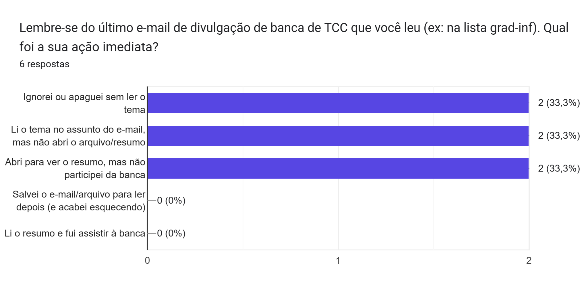
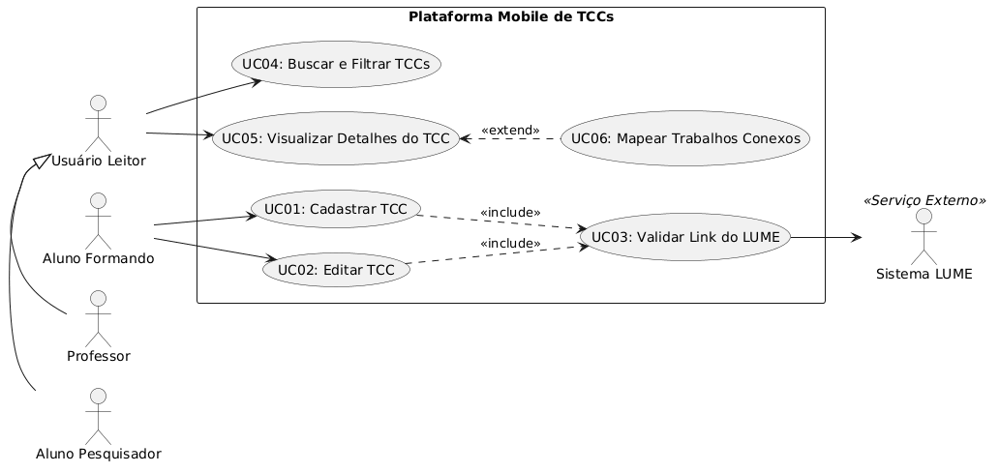
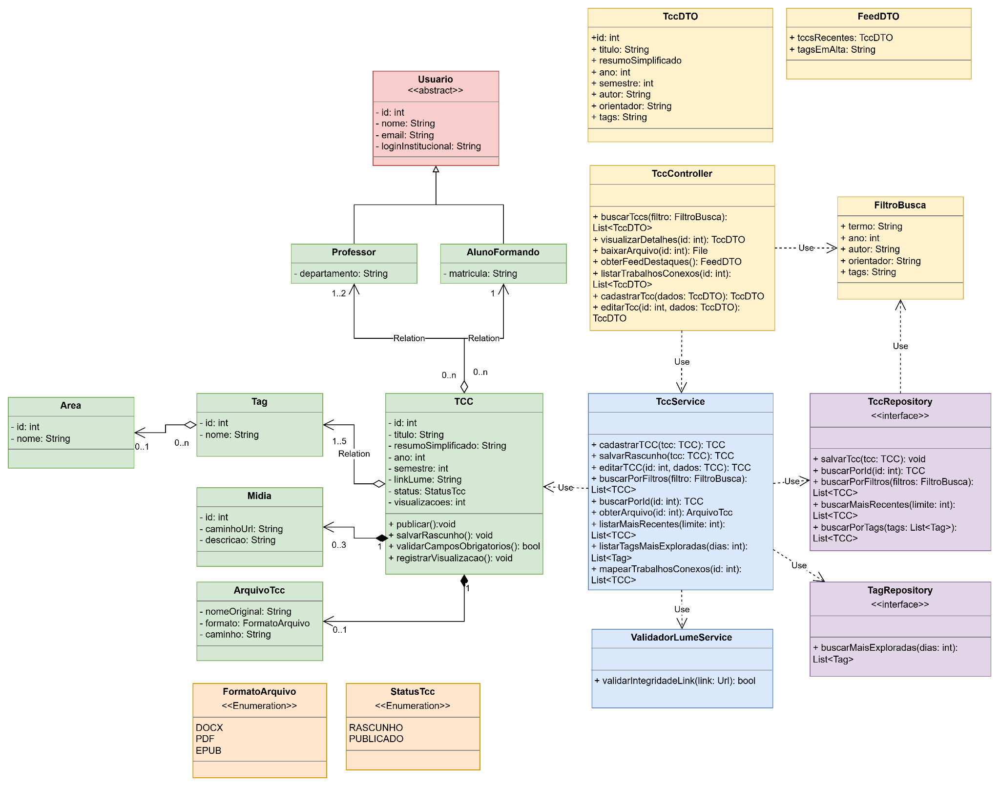
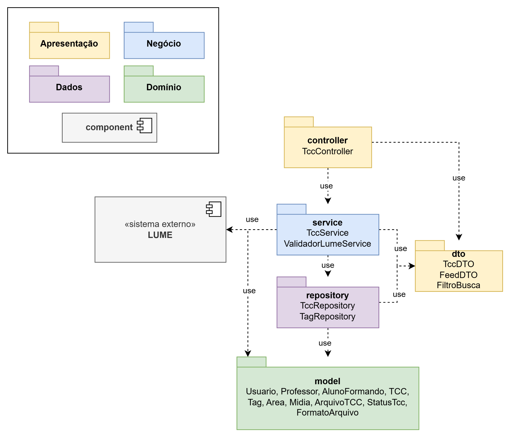
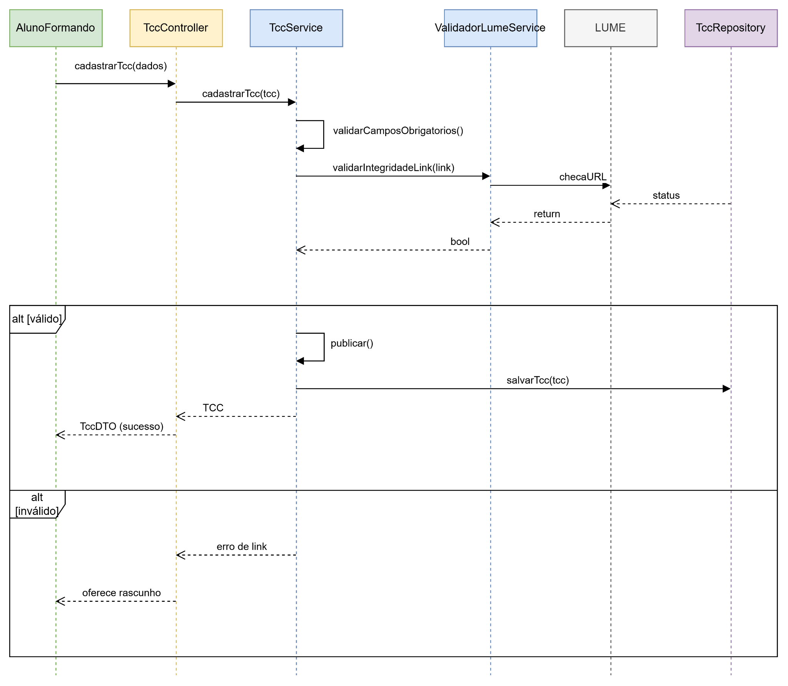
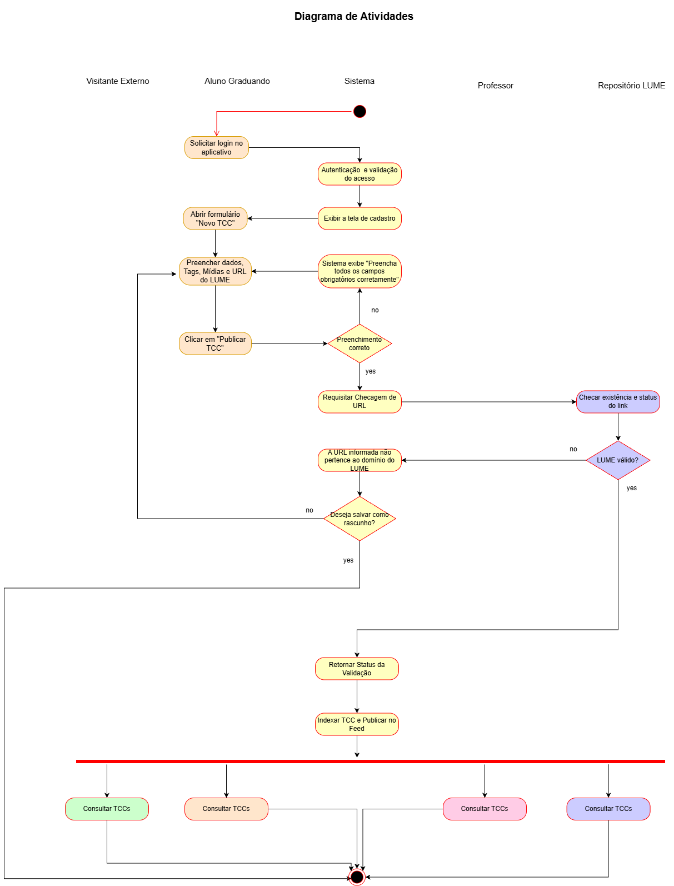
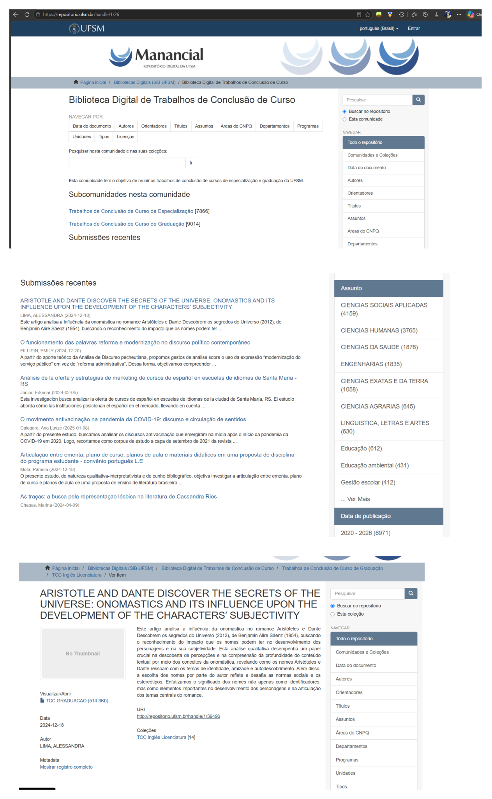
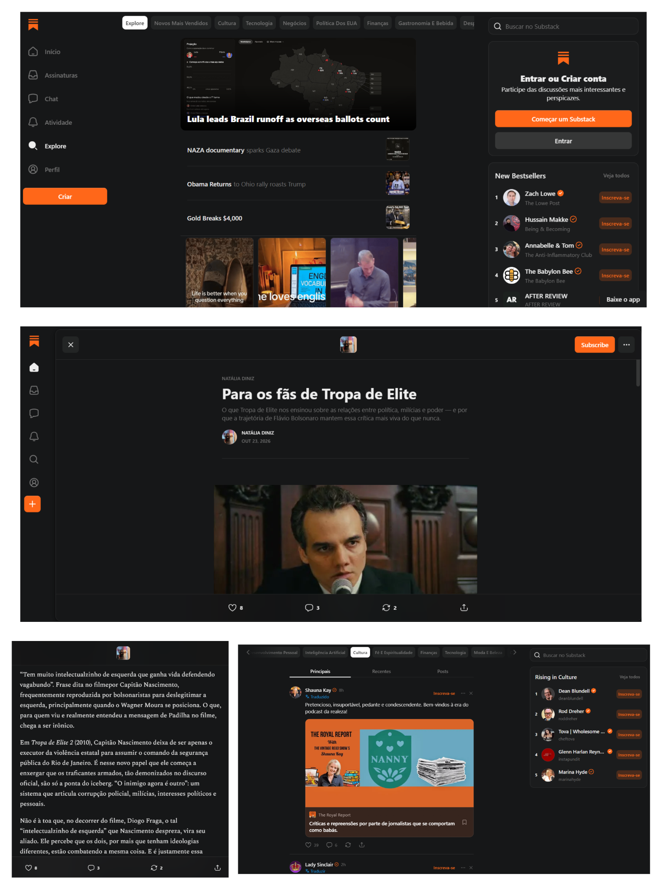
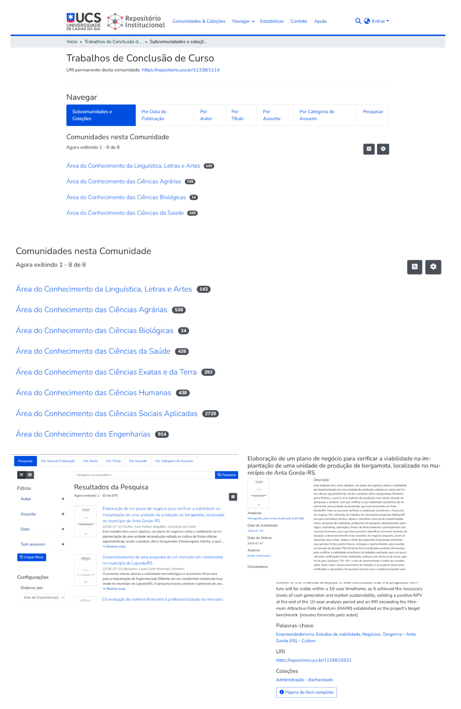
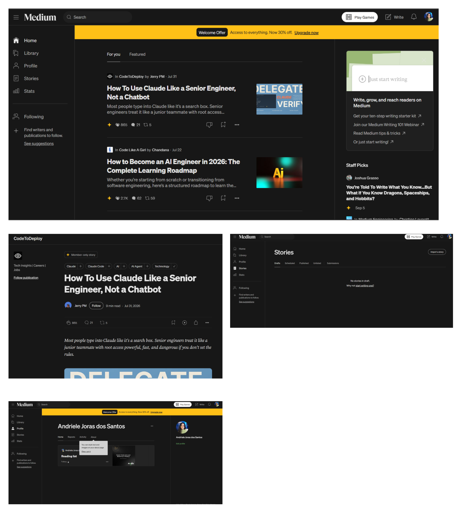

# Especificação do projeto: tornar TCCs de computação visíveis, relacionados e úteis

## 1. Origem e critérios de fidelidade

Documento baseado em [Desafio Engenharia Software](references/Desafio_Engenharia_Software.pdf), com 17 páginas, da disciplina **INF01127 - Engenharia de Software N**, trabalho prático de Engenharia de Software do Instituto de Informática da UFRGS.

**Autores:** Andriele Joras dos Santos (594861), Gabriel Pieruccini Knopp (594975) e Vitor Feijó (588403). **Professora:** Leticia Santos Machado.


Esta especificação reorganiza o conteúdo textual e visual do PDF para orientar a implementação. Preserva os identificadores RF#01, RF#02, US#01, US#04, UC01 a UC06 e CT01 a CT03. A numeração de seções abaixo é própria deste arquivo; as páginas indicadas são as páginas físicas do PDF.

As imagens foram extraídas dos objetos de imagem do PDF, preservando a resolução e a transparência disponíveis. Não são recriações dos diagramas ou capturas de sites atuais. Os links externos são referências reproduzidas do documento, sem verificação externa nesta elaboração.

Para evitar acrescentar decisões ao escopo original:

- **Requisito explícito:** consta no texto, nos testes ou nos diagramas do PDF.
- **Detalhamento derivado:** explicita uma consequência desses elementos; sua origem é indicada.
- **Lacuna ou divergência:** aspecto incompleto ou inconsistente da fonte, registrado na seção 14.
- O PDF não define uma stack executável, infraestrutura de hospedagem, endpoints HTTP ou metas quantitativas de desempenho. Menções a Java/UML contextualizam a modelagem, sem determinar todos esses aspectos.

O plano de execução está em [IMPLEMENTATION_PLAN.md](IMPLEMENTATION_PLAN.md).

A seção 16 registra o requisito adicional definido pelo usuário após a extração: site funcional no GitHub Pages, com CI/CD pelo GitHub Actions. Esse requisito complementa o PDF e não é atribuído aos autores do documento original.

## 2. Escopo, problema e objetivo

**Fonte: páginas 1 a 3, seções 1, 2, 3 e 3.1 do PDF.**

### 2.1. Escopo escolhido

“TCCs e trabalhos acadêmicos: busca, relacionamento, divulgação e acompanhamento”.

Propõe-se uma plataforma **mobile/web interativa** para busca e leitura inteligente, mapeamento por tags e identificação rápida de temas e autores.

### 2.2. Problema

No Instituto de Informática da UFRGS, a divulgação de TCCs ocorre de forma estática por e-mail. Esse formato oculta o conteúdo real e a correlação entre pesquisas, dificulta o entendimento das propostas, desengaja a comunidade acadêmica e prejudica a descoberta e o aproveitamento de novos trabalhos.

### 2.3. Evidência de campo

A Figura 1 apresenta uma pesquisa com **6 respostas** sobre a ação imediata após ler um e-mail de divulgação de banca de TCC, por exemplo, na lista grad-inf.

| Resposta apresentada na imagem                                | Quantidade | Percentual |
| ------------------------------------------------------------- | ---------- | ---------- |
| Ignorei ou apaguei sem ler o tema                             | 2          | 33,3%      |
| Li o tema no assunto do e-mail, mas não abri o arquivo/resumo | 2          | 33,3%      |
| Abri para ver o resumo, mas não participei da banca           | 2          | 33,3%      |
| Salvei o e-mail/arquivo para ler depois (e acabei esquecendo) | 0          | 0%         |
| Li o resumo e fui assistir à banca                            | 0          | 0%         |



Fonte indicada no PDF: [Estudo de Campo: Produção de TCC's (respostas)](https://docs.google.com/spreadsheets/d/1FGdXTo9dYXIdfcJlT2TfHTohle5KujXSGEmhE5pBBHQ/edit?usp=sharing). Os resultados acima foram lidos na imagem do PDF, sem consulta à planilha.

### 2.4. Objetivo

Tornar a leitura acessível com recursos visuais, fomentar o interesse científico, facilitar a conexão de ideias e ampliar o impacto do conhecimento gerado de forma prática e factível.

## 3. Stakeholders, atores e acesso

**Fonte: páginas 1 e 2, seção 2.1; página 5, diagrama de casos de uso.**

| Categoria          | Stakeholder                                      | Papel e interesse                                                                                                                                                                       |
| ------------------ | ------------------------------------------------ | --------------------------------------------------------------------------------------------------------------------------------------------------------------------------------------- |
| Interno e direto   | Aluno de graduação formando/autor                | Cadastrar o próprio TCC, selecionar tags de interesse, enviar imagens de demonstração e acompanhar a visibilidade do trabalho.                                                          |
| Interno e direto   | Professores da universidade                      | Consultar trabalhos de orientandos e colegas, validar informações, identificar trabalhos relacionados, analisar o alcance do grupo de pesquisa e verificar correlações e parcerias.     |
| Interno e indireto | Direção do Instituto de Informática              | Beneficiar-se da valorização institucional e do prestígio acadêmico, sem operar ou gerenciar ativamente o aplicativo.                                                                   |
| Interno e indireto | Biblioteca/Repositório LUME UFRGS                | Manter sua catalogação institucional e custódia dos trabalhos; receber maior procura pelos documentos divulgados.                                                                       |
| Externo e direto   | Comunidade externa e pesquisadores independentes | Estudantes de outras instituições, profissionais de tecnologia e pesquisadores podem pesquisar, ler resumos, visualizar demonstrações e explorar correlações em modo visitante/leitura. |
| Externo e indireto | Comunidade científica e tecnológica nacional     | Descobrir pesquisas do INF-UFRGS e utilizá-las como base teórica ou prática para novos estudos.                                                                                         |
| Externo e indireto | Sociedade e cidadãos                             | Beneficiar-se das soluções, protótipos e tecnologias dos TCCs, como aplicações sociais, de saúde e de segurança.                                                                        |

### 3.1. Regras explícitas de acesso

- Visitantes externos têm permissão de consulta e navegação, sem permissão de escrita ou inserção de dados.
- Publicação e edição são restritas a usuários autenticados com credenciais institucionais da UFRGS.
- O cadastro descrito em UC01 tem como ator principal o aluno formando, autor do próprio trabalho.
- No diagrama, aluno formando, professor e aluno pesquisador são especializações do usuário leitor; todos podem consultar trabalhos.
- O sistema LUME é um serviço externo utilizado na validação de links.
- O texto menciona validação de informações por professores, mas não especifica um fluxo de aprovação ou moderação que anteceda a publicação.

## 4. Benchmark e referências de experiência

**Fonte: páginas 2 e 3, Tabela 1; página 4, benchmark de funcionalidades; anexos 1 a 4.**

| Solução e link original                                                                                  | Funcionalidades e informações relevantes                                                                                        | Críticas registradas                                                                     | Usar como referência                                                    | Não adotar                                                              |
| -------------------------------------------------------------------------------------------------------- | ------------------------------------------------------------------------------------------------------------------------------- | ---------------------------------------------------------------------------------------- | ----------------------------------------------------------------------- | ----------------------------------------------------------------------- |
| [Biblioteca Digital de Trabalhos de Conclusão de Curso da UFSM](https://repositorio.ufsm.br/handle/1/26) | Navegação e filtros por data do documento, autores, orientadores, títulos e assuntos; funcionalidades intuitivas e em destaque. | Não permite selecionar mais de um filtro ao mesmo tempo.                                 | Categorias de filtragem que representam bem as divisões de um TCC.      | Lista contínua que dificulta separar visualmente um TCC de outro.       |
| [Substack](https://substack.com/explore)                                                                 | Pesquisa por tópicos e rolagem vertical; formato próximo de uma rede social facilita acesso e navegação.                        | Dificuldade de distinguir uma publicação de trabalho de outra apenas relacionada à área. | Posts com imagens acompanhando o trabalho e modelo de navegação social. | Chat.                                                                   |
| [Trabalhos de Conclusão de Curso da UCS](https://repositorio.ucs.br/11338/1114)                          | Filtros por subcomunidades e coleções, data, autor, título e assunto; permite filtragens simultâneas.                           | Visualização muito formal, que pode reduzir engajamento.                                 | Visualização dos trabalhos, interface e filtragem.                      | Modelo de filtros como “blocos”; o PDF não detalha um motivo adicional. |
| [Medium](https://medium.com)                                                                             | Leitura de artigos longos; ações de bater palma, responder e repostar; página minimalista voltada ao foco na leitura.           | Não é direcionado à academia e possui paywall bloqueante.                                | Página de leitura e ações de interação como inspiração.                 | Paywall: a proposta é acesso sem esse limite.                           |

### 4.1. Referências específicas por requisito

- **RF#01:** Substack e Medium inspiram uma escrita direta, limpa e visual, em página branca semelhante a um bloco de notas.
- **RF#02:** o feed diário personalizado do Substack e as headlines/tópicos mais quentes do Medium inspiram a descoberta e a listagem visual e acessível de artigos.
- Essas referências não especificam, por si, chat, comentários, palmas, repostagens ou personalização obrigatória no produto. O PDF detalha cadastro, leitura, busca e feed; não apresenta contratos dessas interações sociais.

## 5. Funcionalidades e requisitos

**Fonte: páginas 3 e 4, seções 3.2 a 3.2.1.1.2.**

### 5.1. Funcionalidades gerais anunciadas

1. Cadastro e edição de TCC.
2. Classificação por tags e áreas.
3. Busca multifacetada e semântica.
4. Mapeamento e sugestão de trabalhos conexos.
5. Feed de destaques e descoberta.

O PDF escolhe **duas funcionalidades para análise detalhada**, RF#01 e RF#02. As demais permanecem no escopo geral, com detalhamento parcial em histórias, casos de uso e diagramas. Não há algoritmo de busca semântica ou de recomendação definido.

### 5.2. Sentenças de requisito

| Identificador original                     | Descrição                                                                                                                                                                                                                                                                     |
| ------------------------------------------ | ----------------------------------------------------------------------------------------------------------------------------------------------------------------------------------------------------------------------------------------------------------------------------- |
| **RF#01 - Cadastro e Edição de TCC**       | O sistema deve permitir que o aluno formando cadastre e edite as informações de seu TCC, incluindo título, resumo simplificado, orientador, coorientador, ano/semestre, link do documento oficial no LUME, arquivo DOCX, PDF ou EPUB e até 3 imagens/figuras de demonstração. |
| **RF#02 - Feed de Destaques e Descoberta** | O sistema deve exibir um feed inicial interativo contendo os TCCs defendidos mais recentemente e os tópicos mais explorados no período.                                                                                                                                       |

### 5.3. Problemas associados

- **RF#01:** repositórios institucionais tradicionais são restritivos e não oferecem uma forma ágil e visual de o aluno destacar o próprio trabalho.
- **RF#02:** a busca por trabalhos anteriores é burocrática e baseada apenas em palavras-chave, contribuindo para baixo engajamento com a produção científica.

## 6. Histórias de usuário e critérios de aceitação

**Fonte: páginas 4 e 5, seção 3.2.1.2.**

### 6.1. US#01

> Como aluno formando, quero cadastrar meu TCC com tags, resumo acessível e imagens ilustrativas, para dar visibilidade à minha pesquisa e ser facilmente encontrado por colegas e grupos de pesquisa.

| Dado                                              | Quando                                                | Então                                                         |
| ------------------------------------------------- | ----------------------------------------------------- | ------------------------------------------------------------- |
| Quero cadastrar meu TCC.                          | Preencho as informações e clico na opção de publicar. | O trabalho deve ser divulgado no sistema para outras pessoas. |
| Quero categorizar meu TCC em uma área específica. | Seleciono as tags apropriadas.                        | O trabalho deve ser atribuído àquela classificação.           |
| Quero ilustrar melhor meu trabalho.               | Insiro uma imagem no sistema.                         | A imagem deve ser atribuída ao TCC.                           |

### 6.2. US#04

> Como aluno ingressante ou pesquisador, quero filtrar TCCs por áreas de interesse e tags temáticas, para encontrar referências bibliográficas relevantes e identificar potenciais orientadores.

| Dado                                                             | Quando                                | Então                                                                 |
| ---------------------------------------------------------------- | ------------------------------------- | --------------------------------------------------------------------- |
| Quero visualizar um trabalho de TCC desejado.                    | Clico no trabalho.                    | Seu conteúdo e projeto devem ser abertos e apresentados pelo sistema. |
| Quero acessar um trabalho especificamente da área da computação. | Seleciono o filtro respectivo.        | Trabalhos fora da categoria não devem ficar visíveis.                 |
| Quero pesquisar TCCs associados a um orientando específico.      | Digito seu nome na barra de pesquisa. | Somente os trabalhos desse orientando devem aparecer.                 |

O último critério usa **orientando** na fonte. UC04 também prevê filtro de **orientador**; são critérios distintos e ambos devem ser considerados no detalhamento da busca.

## 7. Casos de uso

### 7.1. Diagrama original

**Fonte: página 5, Figura 2.**



| Caso de uso | Nome no diagrama           | Relações e cobertura na fonte                                             |
| ----------- | -------------------------- | ------------------------------------------------------------------------- |
| UC01        | Cadastrar TCC              | Ator aluno formando; inclui UC03; possui especificação textual.           |
| UC02        | Editar TCC                 | Ator aluno formando; inclui UC03; sem fluxo textual próprio.              |
| UC03        | Validar Link do LUME       | Incluído por UC01 e UC02; interage com o sistema LUME.                    |
| UC04        | Buscar e Filtrar TCCs      | Disponível ao usuário leitor; possui especificação textual.               |
| UC05        | Visualizar Detalhes do TCC | Disponível ao usuário leitor; detalhado parcialmente no fluxo de UC04.    |
| UC06        | Mapear Trabalhos Conexos   | Relação «extend» dirigida a UC05; sem fluxo textual ou algoritmo próprio. |

### 7.2. UC01 - Cadastrar TCC

**Fonte: páginas 5 e 6. Relacionamento: RF#01 e US#01.**

**Objetivo:** permitir que o aluno formando cadastre metadados, links e anexos visuais da pesquisa para publicação no catálogo do aplicativo.

**Ator principal:** Aluno Formando (Autor).

**Pré-condições:**

- Usuário autenticado com credenciais institucionais válidas.
- TCC com registro prévio ou URL ativa no LUME da UFRGS. O fluxo alternativo FA02 trata a falha dessa condição e a possibilidade de rascunho.

**Pós-condição de sucesso:** trabalho indexado, presente no feed e nos resultados de busca, com as tags associadas.

#### Fluxo principal

1. O aluno acessa o menu do perfil e seleciona **“Cadastrar Novo TCC”**.
2. O sistema apresenta formulário com Título, Resumo, Ano/Semestre, Orientador, Coorientador (opcional), Link do LUME, Tags e Mídias.
3. O aluno preenche os campos textuais obrigatórios.
4. O aluno seleciona até **5 tags temáticas**, a partir de sugestões ou digitando novas tags.
5. O aluno anexa até **3 imagens/gráficos** de demonstração.
6. O aluno insere a URL do LUME e o arquivo com as informações, caso existente.
7. O aluno clica em **“Publicar TCC”**.
8. O sistema valida campos obrigatórios e a integridade do link do LUME.
9. O sistema salva os dados, indexa o trabalho e apresenta **“TCC publicado com sucesso!”**.
10. O caso de uso se encerra.

#### FA01 - Campos obrigatórios incompletos

1. No passo 8, o sistema identifica campos obrigatórios ausentes, como Título, Resumo ou Tags.
2. A publicação é impedida; os dados digitados permanecem no formulário.
3. Os campos pendentes são destacados em vermelho e o sistema apresenta **“Preencha todos os campos obrigatórios”**.
4. O aluno completa os campos e clica novamente em “Publicar TCC”.
5. O fluxo retorna ao passo 8.

#### FA02 - Link do LUME inexistente ou inacessível

1. No passo 8, falha a verificação da URL por link quebrado, domínio incorreto ou indisponibilidade do servidor.
2. O sistema apresenta **“A URL informada não pertence ao domínio do LUME ou está inacessível. Deseja salvar como rascunho até que a publicação no LUME esteja homologada?”**.
3. Se o aluno selecionar **“Salvar como rascunho”**, os dados são armazenados sem disponibilização no feed ou na busca.
4. O sistema apresenta **“Rascunho salvo com sucesso”** e encerra o caso de uso.
5. Se o aluno recusar o rascunho, retorna ao formulário com os dados mantidos. Esse ramo consta no CT02 e no diagrama de atividades.

### 7.3. UC04 - Buscar e Filtrar TCCs

**Fonte: páginas 6 e 7. Relacionamento indicado no PDF: RF#02 e US#04.**

**Objetivo:** permitir que aluno pesquisador ou professor, como usuário leitor, explore trabalhos de interesse realizados por alunos formandos.

**Ator principal:** Usuário Leitor. O texto original acrescenta “(Autor)” a esse ator, embora o caso trate de leitura; o diagrama também permite consulta por outros leitores.

**Pré-condição:** TCC previamente registrado no sistema.

**Pós-condições:** resultados compatíveis apresentados ao usuário e documento selecionado disponibilizado para download.

#### Fluxo principal

1. O usuário acessa o menu e seleciona **“Buscar TCC”**.
2. O sistema apresenta barra de pesquisa e botões de filtro por **Data/Ano, Autores, Orientadores, Assuntos/Tags e Coleções**.
3. O usuário insere termos e/ou escolhe filtros.
4. O usuário confirma as seleções e aciona o símbolo de **“Pesquisar”**.
5. O sistema apresenta, em formato de feed, os trabalhos que atendem a **todas as condições simultaneamente**.
6. O usuário seleciona um trabalho listado.
7. O sistema apresenta características e descrição conforme preenchidas pelo autor.
8. O usuário aciona **“Baixar Artigo”**.
9. O sistema transfere o arquivo do trabalho para o dispositivo.
10. O caso de uso se encerra.

#### FA01 - Nenhum trabalho corresponde aos filtros

1. No passo 5, a consulta não encontra trabalhos compatíveis e retorna um feed vazio.
2. O sistema apresenta **“Nenhum trabalho encontrado para os critérios informados. Tente ajustar ou remover alguns filtros.”**.
3. O usuário redefine filtros ou termos e pesquisa novamente.
4. O fluxo retorna ao passo 5.

#### FA02 - Falha durante o download

1. No passo 9, a transferência do artigo falha.
2. O sistema apresenta **“Ocorreu um erro durante o download, verifique a sua conexão com a internet e tente novamente.”**.
3. O usuário pode tentar novamente em “Baixar Artigo”. A narrativa original exemplifica aguardar alguns minutos até a conexão reiniciar; não estabelece espera obrigatória no sistema.
4. O fluxo retorna ao passo 9.

## 8. Regras de negócio e dados de cadastro

**Consolidação derivada de RF#01, UC01, UC04, CT01 a CT03 e diagrama de classes.** Os códigos RN abaixo são locais a esta especificação, não identificadores adicionais do PDF.

| ID local | Regra                                                                                                       | Origem                         |
| -------- | ----------------------------------------------------------------------------------------------------------- | ------------------------------ |
| RN01     | Escrita exige autenticação institucional; visitante apenas consulta.                                        | Stakeholders; UC01.            |
| RN02     | O aluno cadastra e edita o próprio TCC. O mecanismo de verificação de autoria não é descrito.               | Stakeholders; RF#01; UC02.     |
| RN03     | Publicar exige os campos obrigatórios e validação da integridade do link do LUME.                           | UC01, passos 3 e 8.            |
| RN04     | TCC publicado tem de 1 a 5 tags: o fluxo limita a 5, a ausência de tags é inválida e o diagrama marca 1..5. | UC01; FA01; classes.           |
| RN05     | Tags podem ser escolhidas de lista sugerida ou digitadas como novas.                                        | UC01, passo 4.                 |
| RN06     | TCC pode ter de 0 a 3 imagens/figuras de demonstração.                                                      | RF#01; UC01; classes 0..3.     |
| RN07     | Arquivo do trabalho é opcional, com cardinalidade 0..1; formatos DOCX, PDF ou EPUB.                         | UC01, passo 6; classes; RF#01. |
| RN08     | Coorientador é opcional. O modelo representa de 1 a 2 professores por TCC.                                  | UC01; classes.                 |
| RN09     | Estados representados: RASCUNHO e PUBLICADO.                                                                | Classes; CT01; CT02.           |
| RN10     | Rascunho preserva os dados e não aparece no feed nem nos resultados públicos de busca.                      | UC01 FA02; CT02; CT03.         |
| RN11     | Falha de campos obrigatórios ou recusa do rascunho mantém os dados no formulário.                           | UC01 FA01; CT02.               |
| RN12     | Filtros diferentes são aplicados simultaneamente, por interseção das condições.                             | UC04; CT03.                    |
| RN13     | Feed inicial reúne trabalhos defendidos mais recentemente e tópicos mais explorados no período.             | RF#02.                         |
| RN14     | Publicação bem-sucedida indexa o trabalho para descoberta e busca.                                          | UC01; atividades.              |

### 8.1. Campos

| Campo                         | Obrigatoriedade/limite descrito                               | Observação                                                                                       |
| ----------------------------- | ------------------------------------------------------------- | ------------------------------------------------------------------------------------------------ |
| Título                        | Obrigatório.                                                  | Explicitamente citado em FA01.                                                                   |
| Resumo simplificado/acessível | Obrigatório.                                                  | Deve favorecer compreensão da pesquisa.                                                          |
| Ano/Semestre                  | Campo do fluxo principal.                                     | Inteiros no modelo; obrigatoriedade individual e faixa de valores não são enumeradas.            |
| Autor                         | Um aluno formando por TCC no diagrama.                        | Vinculado ao usuário; não listado como entrada manual no formulário.                             |
| Orientador                    | Campo do fluxo principal; modelo exige ao menos um professor. | Diferente do coorientador opcional.                                                              |
| Coorientador                  | Opcional.                                                     | Segundo professor quando presente.                                                               |
| Link do LUME                  | Validado para publicar.                                       | Domínio incorreto, link quebrado ou indisponível conduz a FA02.                                  |
| Tags                          | De 1 a 5 na publicação.                                       | Novas ou sugeridas; mínimo para rascunho não definido.                                           |
| Mídias                        | De 0 a 3.                                                     | Imagens/gráficos; CT01 utiliza PNG, sem restringir todos os envios a PNG.                        |
| Arquivo                       | De 0 a 1, opcional.                                           | DOCX, PDF ou EPUB.                                                                               |
| Área                          | Prevista em classificação, história e modelo.                 | No diagrama, a associação é entre Tag e Area; não há campo direto de área no formulário de UC01. |
| Coleção                       | Filtro previsto em UC04.                                      | Sem entidade ou campo equivalente no diagrama de classes.                                        |

## 9. Infraestrutura e modelagem

**Fonte: páginas 7 a 10, seção 3.2.2; anexo 5 na página 17.**

### 9.1. Diagrama de classes original



O diagrama utiliza tipos e notação próximos de Java/UML. A transcrição abaixo conserva os nomes visíveis; diferenças de capitalização como `ArquivoTcc`/`ArquivoTCC` e `cadastrarTCC`/`cadastrarTcc` existem na fonte.

### 9.2. Modelo de domínio

| Elemento                      | Atributos presentes na imagem                                                                                                                          |
| ----------------------------- | ------------------------------------------------------------------------------------------------------------------------------------------------------ |
| `Usuario` (abstrata)          | `id: int`, `nome: String`, `email: String`, `loginInstitucional: String`.                                                                              |
| `Professor`                   | `departamento: String`; herda de `Usuario`.                                                                                                            |
| `AlunoFormando`               | `matricula: String`; herda de `Usuario`.                                                                                                               |
| `TCC`                         | `id: int`, `titulo: String`, `resumoSimplificado: String`, `ano: int`, `semestre: int`, `linkLume: String`, `status: StatusTcc`, `visualizacoes: int`. |
| `Tag`                         | `id: int`, `nome: String`.                                                                                                                             |
| `Area`                        | `id: int`, `nome: String`.                                                                                                                             |
| `Midia`                       | `id: int`, `caminhoUrl: String`, `descricao: String`.                                                                                                  |
| `ArquivoTcc`                  | `nomeOriginal: String`, `formato: FormatoArquivo`, `caminho: String`.                                                                                  |
| `StatusTcc` (enumeração)      | `RASCUNHO`, `PUBLICADO`.                                                                                                                               |
| `FormatoArquivo` (enumeração) | `DOCX`, `PDF`, `EPUB`.                                                                                                                                 |

**Operações de `TCC`:** `publicar(): void`, `salvarRascunho(): void`, `validarCamposObrigatorios(): bool` e `registrarVisualizacao(): void`.

**Associações e cardinalidades desenhadas:**

- Um TCC está associado a **1 aluno formando**, e o aluno pode estar associado a **0..n TCCs**.
- Um TCC está associado a **1..2 professores**, e um professor pode estar associado a **0..n TCCs**. O texto distingue orientador e coorientador; o desenho não nomeia os papéis individualmente.
- Um TCC agrega **1..5 tags**.
- Uma tag pode estar associada a **0..1 área**; a área pode ter **0..n tags**, conforme as multiplicidades desenhadas.
- Um TCC compõe **0..3 mídias** e **0..1 arquivo**.
- As associações não apresentam todos os limites dos dois lados. Não se deduzem restrições adicionais além das visíveis.

### 9.3. Objetos de transferência e filtro

| Elemento      | Campos tal como representados                                                                                                                               |
| ------------- | ----------------------------------------------------------------------------------------------------------------------------------------------------------- |
| `TccDTO`      | `id: int`, `titulo: String`, `resumoSimplificado` (sem tipo explícito), `ano: int`, `semestre: int`, `autor: String`, `orientador: String`, `tags: String`. |
| `FeedDTO`     | `tccsRecentes: TccDTO`, `tagsEmAlta: String`.                                                                                                               |
| `FiltroBusca` | `termo: String`, `ano: int`, `autor: String`, `orientador: String`, `tags: String`.                                                                         |

Embora alguns nomes indiquem coleções, o desenho usa os tipos singulares acima. O DTO não contém todos os campos necessários para cadastro e leitura; a seção 14 registra a necessidade de completar os contratos na implementação.

### 9.4. Controllers, serviços e repositórios

Métodos transcritos da imagem:

```text
TccController
  buscarTccs(filtro: FiltroBusca): List<TccDTO>
  visualizarDetalhes(id: int): TccDTO
  baixarArquivo(id: int): File
  obterFeedDestaques(): FeedDTO
  listarTrabalhosConexos(id: int): List<TccDTO>
  cadastrarTcc(dados: TccDTO): TccDTO
  editarTcc(id: int, dados: TccDTO): TccDTO

TccService
  cadastrarTCC(tcc: TCC): TCC
  salvarRascunho(tcc: TCC): TCC
  editarTCC(id: int, dados: TCC): TCC
  buscarPorFiltros(filtro: FiltroBusca): List<TCC>
  buscarPorId(id: int): TCC
  obterArquivo(id: int): ArquivoTcc
  listarMaisRecentes(limite: int): List<TCC>
  listarTagsMaisExploradas(dias: int): List<Tag>
  mapearTrabalhosConexos(id: int): List<TCC>

ValidadorLumeService
  validarIntegridadeLink(link: Url): bool

TccRepository (interface)
  salvarTcc(tcc: TCC): void
  buscarPorId(id: int): TCC
  buscarPorFiltros(filtros: FiltroBusca): List<TCC>
  buscarMaisRecentes(limite: int): List<TCC>
  buscarPorTags(tags: List<Tag>): List<TCC>

TagRepository (interface)
  buscarMaisExploradas(dias: int): List<Tag>
```

O controller usa o serviço e `FiltroBusca`. O serviço usa o domínio, os repositórios de TCC e tags e o validador do LUME. O repositório de TCC também usa `FiltroBusca`.

### 9.5. Diagrama de pacotes



| Pacote                      | Responsabilidade/elementos mostrados                                                                                 |
| --------------------------- | -------------------------------------------------------------------------------------------------------------------- |
| `controller` / Apresentação | `TccController`.                                                                                                     |
| `dto` / Apresentação        | `TccDTO`, `FeedDTO`, `FiltroBusca`.                                                                                  |
| `service` / Negócio         | `TccService`, `ValidadorLumeService`.                                                                                |
| `repository` / Dados        | `TccRepository`, `TagRepository`.                                                                                    |
| `model` / Domínio           | `Usuario`, `Professor`, `AlunoFormando`, `TCC`, `Tag`, `Area`, `Midia`, `ArquivoTCC`, `StatusTcc`, `FormatoArquivo`. |
| Sistema externo             | LUME.                                                                                                                |

Dependências desenhadas: controller → service e DTOs; service → repositórios, DTOs, modelo e LUME; repository → DTOs/filtro e modelo. A fonte não especifica banco de dados, framework ou transporte entre frontend e backend.

### 9.6. Diagrama de sequência



Participantes: `AlunoFormando`, `TccController`, `TccService`, `ValidadorLumeService`, `LUME` e `TccRepository`.

1. O aluno chama `cadastrarTcc(dados)` no controller.
2. O controller encaminha `cadastrarTcc(tcc)` ao serviço.
3. O serviço valida os campos obrigatórios.
4. O serviço chama `validarIntegridadeLink(link)` no validador, que checa a URL no LUME.
5. Com link válido, o serviço publica, chama `salvarTcc(tcc)` no repositório e retorna TCC ao controller; o aluno recebe `TccDTO (sucesso)`.
6. Com link inválido, o serviço retorna erro de link e o controller oferece rascunho ao aluno.

Há uma seta `status` desenhada do repositório para o LUME, inconsistente com o fluxo narrado. A imagem foi preservada; isso não estabelece uma responsabilidade nova para o repositório.

### 9.7. Diagrama de atividades



Raias: Visitante Externo, Aluno Graduando, Sistema, Professor e Repositório LUME.

O fluxo mostra solicitação de login, autenticação e validação de acesso, abertura do formulário “Novo TCC”, preenchimento de dados/tags/mídias/URL, validação dos campos e checagem de existência/status do link no LUME. Campos incorretos retornam ao formulário; URL inválida oferece rascunho, com retorno ao preenchimento se recusado. URL válida conduz à indexação e publicação no feed. Após a publicação, o desenho apresenta consultas por diferentes participantes.

A mensagem de campos inválidos aparece no desenho como **“Preencha todos os campos obrigatórios corretamente”**, enquanto UC01 usa a versão sem “corretamente”. A raia LUME termina com uma ação “Consultar TCCs”; não há especificação textual de integração de consulta iniciada pelo repositório externo.

## 10. Casos de teste originais

**Fonte: páginas 10 a 12, seção 3.2.3.** A numeração de passos é reiniciada aqui para facilitar execução; no PDF ela continua entre CT01, CT02 e CT03. Os resultados e dados foram preservados.

### 10.1. CT01 - Cadastrar TCC com dados válidos

**Relacionamento:** RF#01, UC01, US#01. **Tipo:** positivo.

**Pré-condições:** aluno autenticado com credenciais institucionais e link do TCC ativo no LUME.

**Entrada:**

| Campo        | Valor                                     |
| ------------ | ----------------------------------------- |
| Título       | Detecção de anomalias em redes veiculares |
| Resumo       | Texto simplificado preenchido             |
| Ano/Semestre | 2025/2                                    |
| Orientador   | Prof. Carlos Lima                         |
| Coorientador | Em branco                                 |
| Link do LUME | URL válida do repositório                 |
| Tags         | Redes, IA, Segurança                      |
| Mídias       | 2 imagens PNG                             |

**Passos:**

1. Acessar o menu do perfil e selecionar “Cadastrar Novo TCC”.
2. Preencher os campos com os dados acima.
3. Clicar em “Publicar TCC”.

**Resultados esperados:**

- Campos e link validados; mensagem “TCC publicado com sucesso”. UC01 acrescenta uma exclamação à mensagem.
- TCC com status **PUBLICADO**, presente no feed.
- Busca pela tag **Redes** retorna o TCC.

### 10.2. CT02 - Cadastrar TCC com link fora do LUME (FA02)

**Relacionamento:** RF#01, UC01 (FA02). **Tipo:** negativo.

**Pré-condição:** aluno autenticado com credenciais institucionais.

**Entrada:** mesmos dados do CT01, substituindo o link por `http://exemplo.com/tcc-123`.

**Passos:**

1. Abrir “Cadastrar Novo TCC” e preencher os dados.
2. Clicar em “Publicar TCC”.
3. No aviso exibido, selecionar “Salvar como rascunho”.

**Resultados esperados:**

- O sistema não publica e apresenta o aviso completo de URL inválida/inacessível e oferta de rascunho, conforme UC01 FA02.
- Após confirmação, apresenta “Rascunho salvo com sucesso”.
- Status **RASCUNHO**, todos os dados preservados, sem aparecer no feed nem nos resultados de busca.
- **Variação:** recusar o rascunho retorna ao formulário com os dados mantidos, como no diagrama de atividades.

### 10.3. CT03 - Buscar TCCs com filtros combinados

**Relacionamento:** RF#02, UC04, US#04. **Tipo:** positivo.

**Pré-condição:** base com os seguintes trabalhos:

| TCC | Ano/Semestre | Orientador        | Tag   | Status    |
| --- | ------------ | ----------------- | ----- | --------- |
| A   | 2025/1       | Prof. Carlos Lima | Redes | PUBLICADO |
| B   | 2025/1       | Prof. Carlos Lima | IA    | PUBLICADO |
| C   | 2024/2       | Prof. Carlos Lima | Redes | PUBLICADO |
| D   | 2025/1       | Profª Ana Reis    | Redes | PUBLICADO |
| E   | 2025/1       | Prof. Carlos Lima | Redes | RASCUNHO  |

**Passos:**

1. Acessar o menu e selecionar “Buscar TCC”.
2. Selecionar **Ano = 2025**, **Orientador = Carlos Lima** e **Tag = Redes**.
3. Clicar em “Pesquisar”.
4. Abrir o trabalho listado.

**Resultados esperados:**

- O feed apresenta **somente A**. B, C e D não satisfazem todas as condições, e E é rascunho.
- A página do TCC A apresenta as informações preenchidas pelo autor.
- **Variação:** Ano = 2023 e Tag = Redes apresenta a mensagem de nenhum resultado, conforme UC04 FA01.

O campo “Entrada” deste caso está vazio no PDF; os valores de consulta aparecem nos passos e foram preservados nessa forma.

## 11. Diretrizes de interface e qualidade presentes na fonte

- Navegação disponível em plataforma mobile/web.
- Experiência visual, interativa e acessível para leitura e descoberta.
- Cadastro com escrita limpa e direta, inspirado em página branca/bloco de notas.
- Listagens em feed com separação visual entre trabalhos e imagens de demonstração.
- Leitura focada e minimalista, inspirada no Medium.
- Filtros simultâneos e categorias identificáveis; evitar o modelo de blocos criticado no benchmark da UCS.
- Erros de obrigatoriedade destacados em vermelho e preservação de dados após erro.
- Acesso sem paywall; consulta pública e escrita institucionalmente autenticada.

O PDF não estabelece critérios formais de acessibilidade, navegadores suportados, disponibilidade, latência, capacidade de armazenamento, volume de usuários, backup ou observabilidade. Esses pontos exigem decisões de implementação e não são apresentados aqui como exigências originais quantificadas.

## 12. Uso de GenAI declarado pelos autores

**Fonte: página 12, seção 3.3.** Esta seção registra o processo descrito no trabalho, sem estabelecer uma funcionalidade de IA obrigatória na plataforma.

1. **Pesquisa de campo:** Gemini foi utilizado para incorporar e realinhar um formulário a partir do rascunho dos autores; posteriormente, para incorporar melhorias conforme o modelo de entrevista e o objetivo da pesquisa. Referência: [conversa Gemini sobre pesquisa](https://share.gemini.google/ouLnuyFXZJ3H).
2. **Diagrama de classes:** após revisão de requisitos e benchmarks, a estrutura inicial foi enviada ao Gemini para apoiar a modelagem de negócio em Java/UML. A estrutura foi revisada pelos autores e avaliada no Claude sem contexto prévio. Referências: [conversa Gemini sobre classes](https://share.gemini.google/CrnBiwDg6rvS) e [avaliação Claude](https://claude.ai/share/08d0be6d-e8ba-49ce-a043-0fc15ea5d16d).
3. **Diagramas de pacotes e sequência:** gerados com apoio da mesma ferramenta, a partir da validação do diagrama de classes e seguindo UML.
4. **Casos de teste:** o contexto do Claude foi utilizado para gerar três casos a partir dos requisitos numerados e critérios de aceite. Referência: [conversa Claude sobre testes](https://claude.ai/share/7bbd4114-36e6-46b7-8e74-d572b017c3fa).

Os autores declaram ter avaliado as saídas, conferindo aderência aos requisitos, ideias, atividades e casos de uso, e relatam forte fidelidade das ferramentas ao contexto fornecido.

## 13. Anexos visuais e inventário de imagens

### 13.1. Anexo 1 - Análise visual: Repositório Digital da UFSM

**Fonte: página 13.**



### 13.2. Anexo 2 - Análise visual: Substack

**Fonte: página 14.**



### 13.3. Anexo 3 - Análise visual: Trabalhos de Conclusão de Curso da UCS

**Fonte: página 15.**



### 13.4. Anexo 4 - Análise visual: Medium

**Fonte: página 16.**



### 13.5. Anexo 5 - Diagrama de atividades

**Fonte: página 17.** Incorporado e descrito na seção 9.7.

### 13.6. Inventário completo

| Arquivo em `docs/images/spec/`      | Página | Conteúdo                      | Resolução extraída |
| ----------------------------------- | ------ | ----------------------------- | ------------------ |
| `logo_inf_ufrgs.png`                | 1      | Logotipo institucional        | 378 × 270          |
| `figura_01_pesquisa_alunos_inf.png` | 1      | Figura 1: gráfico de pesquisa | 2048 × 1041        |
| `figura_02_diagrama_casos_uso.png`  | 5      | Figura 2: casos de uso        | 1033 × 489         |
| `diagrama_classes.png`              | 8      | Classes                       | 2048 × 1612        |
| `diagrama_pacotes.png`              | 9      | Pacotes                       | 2048 × 1756        |
| `diagrama_sequencia.png`            | 10     | Sequência                     | 2048 × 1784        |
| `anexo_01_repositorio_ufsm.png`     | 13     | Benchmark UFSM                | 1263 × 2048        |
| `anexo_02_substack.png`             | 14     | Benchmark Substack            | 1524 × 2048        |
| `anexo_03_repositorio_ucs.png`      | 15     | Benchmark UCS                 | 1334 × 2048        |
| `anexo_04_medium.png`               | 16     | Benchmark Medium              | 1847 × 2048        |
| `anexo_05_diagrama_atividades.png`  | 17     | Atividades                    | 1213 × 1594        |

Os anexos 1 a 4 contêm montagens de capturas; cada montagem é um único objeto de imagem no PDF. As imagens com transparência devem ser visualizadas sobre fundo claro para manter a legibilidade das linhas e textos pretos.

## 14. Lacunas, divergências e decisões pendentes

Estas observações preservam os limites da fonte. Não representam alterações silenciosas dos requisitos.

| ID local | Ponto a resolver                                      | Evidência e limite da especificação                                                                                                                                                                                             |
| -------- | ----------------------------------------------------- | ------------------------------------------------------------------------------------------------------------------------------------------------------------------------------------------------------------------------------- |
| D01      | Stack e forma de entrega mobile/web                   | A solução é descrita como mobile/web e o relato cita modelagem Java/UML; não define framework, banco, hospedagem, aplicativo nativo ou web responsiva.                                                                          |
| D02      | Integração de autenticação UFRGS                      | Exige credenciais institucionais válidas, mas não informa provedor, protocolo, acesso de desenvolvimento ou forma de obter os vínculos aluno/professor.                                                                         |
| D03      | Obrigatoriedade de cada campo e rascunhos incompletos | Título, resumo e tags são explicitamente obrigatórios; coorientador e arquivo são opcionais. Não há matriz completa de validação, limites de texto ou mínimo de campos de rascunho.                                             |
| D04      | Validação LUME                                        | Exige domínio correto e integridade/acessibilidade; não define domínios/aliases aceitos, caminhos, redirecionamentos, timeout ou tratamento técnico de indisponibilidade.                                                       |
| D05      | Download sem arquivo anexado                          | Arquivo é opcional em UC01/classes, mas UC04 inclui download. Não há comportamento especificado quando o TCC só possui URL do LUME.                                                                                             |
| D06      | Edição e republicação                                 | UC02 e RF#01 exigem edição e UC03 incluído, mas não detalham formulário, revalidação, atualização de índice nem destino de uma publicação cuja nova URL seja inválida.                                                          |
| D07      | Recentes e tópicos em alta                            | RF#02 fala em defesa recente; o modelo só tem ano/semestre. Há `visualizacoes` e consulta por `dias`, mas não há data de defesa/publicação, registro temporal de eventos, janela padrão ou fórmula de popularidade.             |
| D08      | Busca semântica                                       | Anunciada entre as features, sem algoritmo, provedor, uso de embeddings, corpus, ordenação ou critério de aceite.                                                                                                               |
| D09      | Trabalhos conexos                                     | UC06, `buscarPorTags` e `mapearTrabalhosConexos` aparecem nos diagramas, sem pontuação, critérios de inclusão, limite ou ordenação definidos.                                                                                   |
| D10      | Áreas, coleções e filtros                             | Áreas estão na história/modelo e coleções em UC04; `FiltroBusca` só representa termo, ano, autor, orientador e tags. Faltam contrato completo, modelo de coleção, filtro de semestre/data e semântica entre múltiplas tags.     |
| D11      | DTOs incompletos                                      | `TccDTO` omite link, status, coorientador, mídia e arquivo; `FeedDTO` apresenta tipos singulares para nomes que sugerem coleções. Não se devem perder dados do requisito ao concretizar os contratos.                           |
| D12      | Rastreabilidade RF#02                                 | A sentença de RF#02 define feed; UC04, US#04 e CT03 tratam busca/filtros e são relacionados a RF#02 no PDF. Essa associação foi mantida sem renumerar a fonte.                                                                  |
| D13      | Moderação, interação e métricas de visibilidade       | Professores validam informações na descrição dos stakeholders; interações sociais são inspiração; o modelo conta visualizações. Não há fluxo de aprovação, painel de métricas, comentários, palmas ou repostagens especificado. |
| D14      | Diagramas e mensagens                                 | Existem diferenças de capitalização, mensagem de obrigatoriedade, a seta `status` na sequência e a ação final de consulta na raia LUME. Preservar os originais e documentar a normalização antes de codificar.                  |
| D15      | Uploads e qualidade operacional                       | Não há tamanhos máximos, extensões de imagem, política de retenção, cotas, metas de desempenho ou requisitos operacionais mensuráveis.                                                                                          |

## 15. Rastreabilidade consolidada

| Elemento                        | Artefatos relacionados                                      | Páginas de origem |
| ------------------------------- | ----------------------------------------------------------- | ----------------- |
| Problema, escopo e stakeholders | Pesquisa de campo; Figura 1                                 | 1-2               |
| Referências de produto          | Tabela 1; anexos 1-4                                        | 2-3, 13-16        |
| RF#01                           | US#01; UC01; UC02; UC03; CT01; CT02                         | 4-6, 10-11        |
| RF#02                           | Feed; US#04; UC04; UC05; CT03, conforme associação original | 4-7, 11-12        |
| Classificação                   | US#01; US#04; UC01; UC04; `Tag`; `Area`                     | 3-6, 8            |
| Conexões                        | UC06; controller/service; consulta por tags                 | 3, 5, 8           |
| Arquitetura                     | Classes; pacotes; sequência                                 | 7-10              |
| Fluxo de cadastro               | UC01; CT01; CT02; anexo 5                                   | 5-6, 10-11, 17    |
| Processo de GenAI               | Declaração dos autores e referências                        | 12                |

## 16. Requisito adicional - Site no GitHub com CI/CD

**Origem:** orientação do usuário posterior à elaboração da especificação do PDF. Esta seção define a direção de entrega do projeto; o estado real de implementação e publicação é registrado em [DELIVERY_M0.md](DELIVERY_M0.md).

### 16.1. Forma de entrega e arquitetura

- A aplicação será um **site responsivo**, utilizável em celular e desktop, com frontend publicado no **GitHub Pages** a partir deste repositório.
- O **GitHub Actions** executará integração contínua e publicação contínua do frontend.
- O frontend deverá gerar HTML, CSS, JavaScript e demais arquivos estáticos. Recursos que dependem de servidor, como autenticação institucional, persistência compartilhada, autorização, arquivos privados e validação de acessibilidade do LUME, usarão um backend/API ou serviços gerenciados externos ao Pages.
- O provedor do backend, banco e armazenamento permanece a definir na escolha de stack. A hospedagem do frontend e a plataforma de CI/CD já estão definidas.
- Dados cadastrados devem persistir entre sessões e ser compartilhados conforme as permissões. Armazenamento apenas no navegador pode apoiar preferências ou demonstrações identificadas, mas não satisfaz cadastro/publicação multiusuário.
- Autorizações e proteção de rascunhos devem ser verificadas no serviço de dados/backend. Esconder controles na interface não substitui essa verificação.

O GitHub Pages publica arquivos estáticos; o workflow de Actions executa build/deploy, mas não funciona como servidor permanente para requisições da aplicação. Referências: [sobre GitHub Pages](https://docs.github.com/en/pages/getting-started-with-github-pages/what-is-github-pages) e [workflows personalizados de Pages](https://docs.github.com/en/pages/getting-started-with-github-pages/using-custom-workflows-with-github-pages).

### 16.2. Requisitos de integração contínua

| ID adicional | Requisito                                                                                                                                                             |
| ------------ | --------------------------------------------------------------------------------------------------------------------------------------------------------------------- |
| GH01         | Executar instalação reproduzível de dependências, lint, verificação de tipos/compilação, testes relevantes e build em pull requests e pushes para a branch principal. |
| GH02         | Impedir a publicação de uma revisão cuja validação falhe; o job de deploy deve depender do sucesso do CI/build da mesma revisão.                                      |
| GH03         | Validar o artefato no caminho de projeto do Pages, incluindo recursos estáticos, navegação e abertura direta/recarregamento das URLs suportadas.                      |
| GH04         | Pull requests devem validar o código sem publicar no site de produção nem receber credenciais de deploy/backend.                                                      |

### 16.3. Requisitos de publicação contínua

| ID adicional | Requisito                                                                                                                                                                                          |
| ------------ | -------------------------------------------------------------------------------------------------------------------------------------------------------------------------------------------------- |
| GH05         | Após push validado na branch principal, publicar automaticamente o artefato estático pelo fluxo oficial do GitHub Pages; permitir execução manual para uma revisão autorizada dessa branch.        |
| GH06         | Usar o ambiente `github-pages`, permissões mínimas por job e `GITHUB_TOKEN`/identidade temporária do workflow para o deploy, sem token pessoal exposto no frontend.                                |
| GH07         | Publicar somente a pasta de saída do build, excluindo configurações privadas, rascunhos, credenciais e arquivos internos que não pertençam ao site.                                                |
| GH08         | Configurar Pages com a origem **GitHub Actions** e ajustar a URL base ao nome real do repositório. Para o remoto atual `vitorsfeijo/Subtccstack`, o caminho de projeto previsto é `/Subtccstack/`. |
| GH09         | Configurar as URLs de retorno do login e as origens permitidas da API para o endereço real do Pages; callbacks de autenticação precisam funcionar no site publicado.                               |
| GH10         | Validar após o deploy a página inicial e o carregamento do frontend, e conferir os fluxos integrados com o backend no ambiente real. Uma falha posterior deve ser visível na execução.             |
| GH11         | Permitir recuperar a versão anterior por reversão de código e novo deploy validado; mudanças de banco precisam de estratégia própria de compatibilidade/recuperação.                               |

As etapas e a separação build/deploy seguem a [documentação oficial de workflows para GitHub Pages](https://docs.github.com/en/pages/getting-started-with-github-pages/using-custom-workflows-with-github-pages). As versões concretas das actions serão escolhidas e fixadas na implementação.

### 16.4. Integrações e configuração

- URL pública de API e identificadores explicitamente públicos podem ser incorporados ao frontend. Credenciais administrativas, chaves de assinatura, senhas de banco e segredos de serviços permanecem no backend ou no ambiente de execução apropriado; variáveis incorporadas ao bundle ficam acessíveis ao visitante.
- Requisições do frontend ao backend devem aceitar a origem configurada do Pages. A validação externa do LUME deve ocorrer no backend quando exigir recursos que o navegador não pode acessar diretamente.
- Uma SPA deverá adotar navegação compatível com o Pages, por exemplo rotas em hash; outra abordagem deve comprovar abertura direta e recarregamento sem depender de reescrita de URLs por servidor próprio.
- Configuração e deploy do backend/banco são separados do deploy estático. O plano deve documentar como provisionar esses serviços e, se forem automatizados por Actions, manter permissões e segredos separados dos jobs de pull request.

### 16.5. Critério de entrega

O resultado esperado é o **site da aplicação**, acessível pela URL do Pages, com os fluxos acordados funcionando e publicação automatizada. Renderizar apenas o README/documentação ou manter todos os dados exclusivamente no navegador não satisfaz esse objetivo.

A conclusão deve apresentar a URL efetivamente publicada, execução de CI/deploy bem-sucedida e evidência de funcionamento de consulta pública, publicação por autor autorizado, rascunhos privados e persistência compartilhada. Integrações institucionais simuladas continuam identificadas como simulações e não comprovam integração real com a UFRGS.
